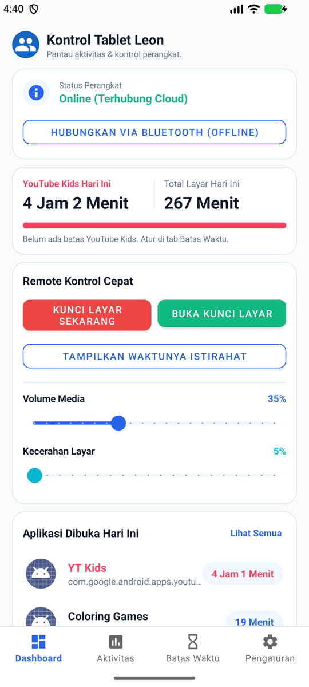
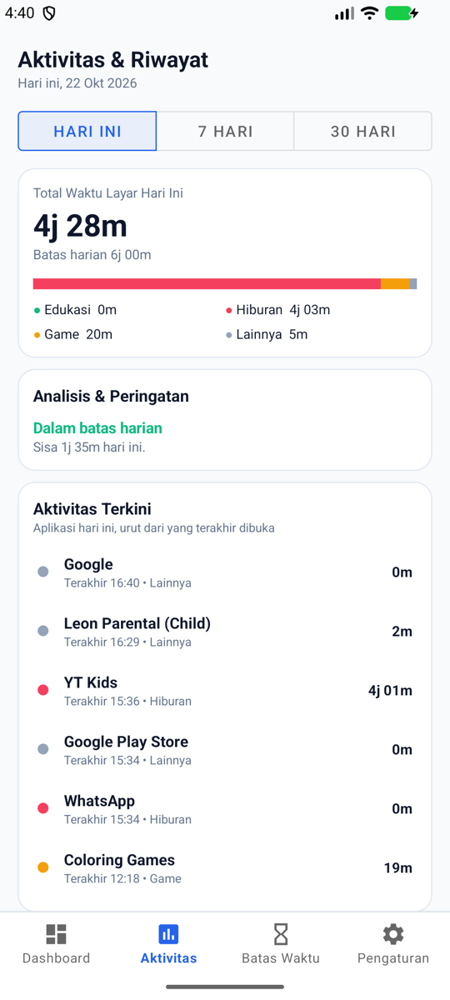
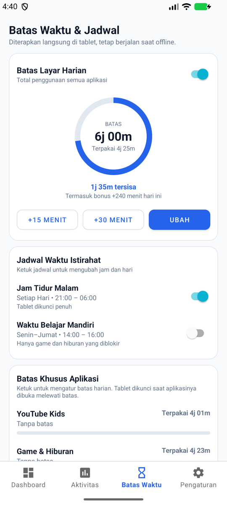
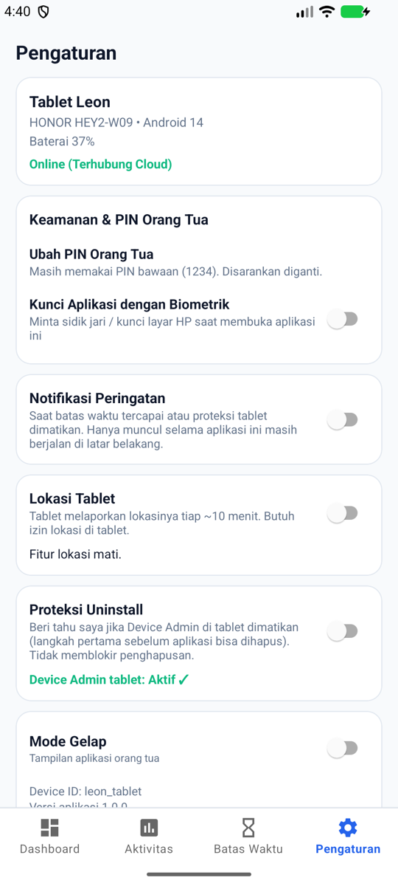

# Parental Control untuk Leon (Android Pair App)

Sepasang aplikasi Android (Native Kotlin) yang dirancang untuk memantau dan mengontrol aktivitas tablet anak (**Leon**), khususnya penggunaan **YouTube Kids**.

Aplikasi ini terdiri dari dua modul:
1. **`child-app`**: Dipasang di tablet Android Leon. Berjalan sebagai *foreground service* yang memantau durasi aplikasi, **menegakkan batas waktu sendiri (tetap jalan saat offline)**, mengunci layar, mengatur volume/brightness, melaporkan lokasi (opsional), dan menyediakan server Bluetooth (BLE) saat Wi-Fi dimatikan.
2. **`parent-app`**: Dipasang di HP orang tua. Berfungsi sebagai dashboard pemantau, riwayat penggunaan, pengatur batas waktu dan jadwal, serta remote kontrol (lock screen, volume, kecerahan, dan koneksi Bluetooth darurat).

---

## 📸 Tampilan Aplikasi Orang Tua

<table>
  <tr>
    <td align="center"><br><b>Dashboard</b><br>Status, YouTube Kids, remote kontrol</td>
    <td align="center"><br><b>Aktivitas &amp; Riwayat</b><br>Grafik 7/30 hari, kategori, analisis</td>
    <td align="center"><br><b>Batas Waktu &amp; Jadwal</b><br>Batas harian, jadwal, batas per aplikasi</td>
    <td align="center"><br><b>Pengaturan</b><br>PIN, biometrik, notifikasi, lokasi</td>
  </tr>
</table>

> Tampilan mengikuti redesign di Google Stitch ("Parental Control App Redesign"). Mode gelap tersedia di tab Pengaturan.

---

## 🚀 Fitur Utama

### Dashboard
- ⏱️ **Pemakaian YouTube Kids hari ini** dengan progress bar yang mengikuti batas YouTube Kids (jika diatur) dan total waktu layar.
- 📶 **Dua jalur kontrol**:
  - **Saat online**: perintah dikirim lewat **Firebase Realtime Database**.
  - **Saat Wi-Fi mati / offline**: tablet menjalankan **BLE GATT Server**; HP orang tua terhubung via **Bluetooth Low Energy** dalam jarak dekat untuk kunci layar, atur volume, atau menyalakan Wi-Fi kembali.
- 🔊 **Volume & kecerahan** tablet lewat slider dari HP orang tua.
- 🔒 **Lock screen ganda**:
  - **System Lock**: `DevicePolicyManager.lockNow()` mengunci dan mematikan layar.
  - **Layar Istirahat**: overlay layar penuh ramah anak ("Waktunya Istirahat, Leon! 🌟") dengan alasan penguncian dan verifikasi **PIN Orang Tua** untuk membuka manual.

### Aktivitas & Riwayat
- 📊 Total waktu layar untuk **Hari Ini / 7 Hari / 30 Hari** dengan grafik batang per hari.
- 🗂️ Rincian per kategori: **Edukasi, Hiburan, Game, Lainnya** (kategori ditentukan otomatis di tablet).
- 💡 **Analisis & peringatan**: tren naik/turun dibanding hari-hari sebelumnya dan status batas harian.
- 🕘 **Aktivitas terkini**: aplikasi hari ini, diurutkan dari yang terakhir dibuka.

### Batas Waktu & Jadwal
Semua aturan **ditegakkan langsung di tablet** dan disimpan lokal, sehingga tetap berlaku saat offline atau setelah restart.
- ⏳ **Batas layar harian** dengan cincin progres, tombol **+15 / +30 menit** (bonus hanya untuk hari itu), dan tombol ubah.
- 🌙 **Jam tidur malam**: tablet dikunci penuh pada jam yang dipilih (bisa melewati tengah malam, per hari).
- 📚 **Waktu belajar mandiri**: hanya game dan hiburan yang diblokir.
- 🎯 **Batas khusus aplikasi**: YouTube Kids, Game & Hiburan, dan Aplikasi Edukasi, masing-masing dengan batas menit per hari (atau tanpa batas).
- Semua pengaturan **nonaktif secara bawaan**; tablet tidak akan terkunci sebelum orang tua menyalakannya. Pembukaan manual (tombol Buka Kunci atau PIN) menjeda penegakan selama 10 menit.

### Pengaturan
- 🔑 **Ubah PIN orang tua** (PIN bawaan `1234`). PIN disimpan sebagai hash bergaram.
- 👆 **Kunci aplikasi dengan biometrik / kunci layar HP** untuk membuka aplikasi orang tua.
- 🔔 **Notifikasi peringatan** saat batas waktu tercapai atau proteksi tablet dimatikan.
- 📍 **Lokasi tablet** (opsional): dilaporkan tiap ~10 menit, dengan tombol **Buka di Maps**.
- 🛡️ **Proteksi uninstall**: peringatan ke orang tua jika Device Admin tablet dimatikan.
- 📱 **Profil perangkat**: model tablet, versi Android, baterai, dan status koneksi.
- 🔐 **Akun keluarga**: aplikasi meminta masuk dengan akun Firebase (email/password) sebelum menampilkan apa pun; tombol **Keluar** ada di Pengaturan.
- 🌗 **Mode gelap**.

### ⚠️ Batasan yang perlu diketahui
- **Proteksi uninstall tidak memblokir penghapusan aplikasi.** Ia hanya memberi peringatan saat Device Admin dimatikan. Pemblokiran sungguhan butuh *Device Owner*, yang harus diatur saat tablet di-reset pabrik.
- **Notifikasi bukan push.** Notifikasi hanya muncul selama aplikasi orang tua masih berjalan di latar belakang.
- **SafeSearch dan filter web belum tersedia.** Fitur itu butuh VPN lokal atau Accessibility Service.
- **Keamanan Firebase.** Database hanya aman jika aturan di `database.rules.json` sudah Anda terapkan (lihat langkah setup). Tanpa itu, siapa pun yang tahu alamat database bisa membaca dan mengubah data. Kedua aplikasi berbagi **satu akun keluarga**, jadi yang memegang sesi di tablet (mis. lewat root/ADB) memegang akses penuh. PIN 4 digit yang di-hash tetap bisa ditebak oleh pemegang akun.
- **Kontrol Wi-Fi** dari jarak jauh hanya berfungsi di Android 9 ke bawah.
- **Layar istirahat tidak menahan layar menyala.** Layar mengikuti timeout bawaan tablet dan mati sendiri; penegakan batas waktu tidak membangunkannya. Saat layar dinyalakan lagi, tablet langsung diperiksa dan layar istirahat muncul kembali bila batas masih berlaku. Jika anak menekan Home, layar istirahat dimunculkan lagi dalam hitungan detik.
- Beberapa merek (mis. HONOR, Xiaomi) mematikan service latar belakang lewat optimasi baterai. Nonaktifkan optimasi baterai untuk aplikasi child di tablet.

---

## 📁 Struktur Direktori Proyek

```
parental-control/
├── child-app/                       # Modul Tablet Leon
│   ├── src/main/
│   │   ├── AndroidManifest.xml      # Izin UsageStats, DeviceAdmin, Overlay, BLE, Lokasi + <queries>
│   │   ├── res/                     # UI Setup Checklist & Lock Overlay
│   │   └── java/com/parentalcontrol/child/
│   │       ├── manager/             # AppUsageManager, DeviceControlManager, BleServerManager,
│   │       │                        #   LimitEnforcer (logika batas waktu), LimitsStore, SettingsStore,
│   │       │                        #   LocationReporter, AlertWriter, PinHasher
│   │       ├── model/               # AppUsageInfo, LimitsConfig, DeviceSettings, AppCategory
│   │       ├── service/             # ChildMonitoringService, ChildFcmService
│   │       ├── receiver/            # AdminReceiver, BootReceiver
│   │       └── ui/                  # MainActivity, LockOverlayActivity
│   └── src/test/                    # Unit test logika murni (LimitEnforcer, kategori, PIN)
├── parent-app/                      # Modul HP Orang Tua
│   ├── src/main/java/com/parentalcontrol/parent/
│   │   ├── ble/                     # BleClientManager (Scanner & Transmitter)
│   │   ├── firebase/                # FirebaseSyncManager (listener & penulis data)
│   │   ├── analysis/                # UsageAnalysis, ScheduleFormat, SecurityLogic (bebas Android)
│   │   ├── model/                   # DeviceSummary, LimitsConfig, DeviceSettings
│   │   └── ui/                      # LoginActivity, MainActivity (navigasi bawah), ParentViewModel,
│   │                                #   Dashboard/Activity/Limits/SettingsFragment, BarChartView
│   └── src/test/                    # Unit test analisis riwayat, PIN, peringatan, kunci aplikasi
├── database.rules.json              # Aturan Realtime Database (hanya akun keluarga) - terapkan manual
├── docs/screenshots/                # Screenshot untuk README
├── gradle/libs.versions.toml        # Version Catalog Gradle
├── build.gradle.kts                 # Root Gradle
└── settings.gradle.kts
```

---

## 🗄️ Struktur Data Firebase

Semua data berada di `devices/leon_tablet`. Kedua aplikasi memegang kontrak yang sama secara terpisah, jadi ubah keduanya bersamaan.

| Node | Penulis | Isi |
|---|---|---|
| `summary` | tablet | Ringkasan pemakaian hari ini, kategori, volume, kecerahan, baterai, status Device Admin |
| `history/{yyyy-MM-dd}` | tablet | Ringkasan per hari (disimpan ±35 hari) untuk tab Aktivitas |
| `isOnline`, `lastHeartbeat` | tablet | Status koneksi |
| `pendingCommand` | HP orang tua | Perintah instan (kunci, volume, kecerahan, dll.), dihapus tablet setelah dijalankan |
| `config` | HP orang tua | Batas harian, aturan per aplikasi, jam tidur, waktu belajar (satu string JSON) |
| `settings` | HP orang tua | Lokasi aktif/tidak dan proteksi uninstall (satu string JSON) |
| `pin` | HP orang tua | Salt dan hash PIN orang tua |
| `location` | tablet | Lokasi terakhir (hanya jika fitur lokasi aktif) |
| `lastAlert` | tablet | Peringatan terakhir (batas tercapai / Device Admin dimatikan) |

---

## 🛠️ Langkah Menjalankan Proyek

### 1. Buka di Android Studio
Buka folder `parental-control` di **Android Studio** (Hedgehog / Iguana / Jellyfish atau versi terbaru). Android Studio akan otomatis mengunduh Gradle wrapper dan dependensi yang dibutuhkan.

Build dan test dari terminal:

```bash
./gradlew :child-app:assembleDebug :parent-app:assembleDebug
./gradlew :child-app:testDebugUnitTest :parent-app:testDebugUnitTest
```

Jika Gradle melaporkan tidak ada Java Runtime, arahkan `JAVA_HOME` ke JDK bawaan Android Studio (di macOS: `/Applications/Android Studio.app/Contents/jbr/Contents/Home`).

### 2. Setup Firebase
1. Buat proyek baru di [Firebase Console](https://console.firebase.google.com/).
2. Daftarkan 2 aplikasi Android di Firebase Console:
   - Package 1: `com.parentalcontrol.child` -> Download `google-services.json` dan letakkan di dalam folder `child-app/`.
   - Package 2: `com.parentalcontrol.parent` -> Download `google-services.json` dan letakkan di dalam folder `parent-app/`.

   File `google-services.json` tidak ikut di-commit (ada di `.gitignore`), tetapi build gagal tanpanya.
3. Aktifkan **Realtime Database** (buat database, lokasi bebas).
4. **Amankan database dengan akun keluarga.** Kedua aplikasi masuk dengan satu akun yang sama:
   1. **Authentication → Sign-in method** → aktifkan **Email/Password**.
   2. **Authentication → Users → Add user**: buat satu akun (email + password yang kuat), lalu salin **User UID**-nya.
   3. Buka [database.rules.json](database.rules.json), ganti **kedua** `GANTI_DENGAN_UID_AKUN_KELUARGA` dengan UID tadi.
   4. **Realtime Database → Rules**: tempel isi file itu, lalu **Publish**.

   > **Urutan penting saat memperbarui instalasi lama:** buat akun (langkah 1-2) dan pasang versi aplikasi terbaru di tablet dan HP, masuk di keduanya, **baru** terapkan aturan (langkah 3-4). Versi lama tidak bisa masuk dan akan berhenti bekerja begitu aturan baru aktif.
   >
   > Mengatur ulang aturan menjadi terbuka (`".read": true, ".write": true`) hanya untuk uji coba singkat; jangan dipakai sungguhan.

### 3. Instalasi di Tablet Leon (`child-app`)
1. Pilih konfigurasi run `child-app` di Android Studio dan install ke tablet.
2. Buka aplikasi **Leon Parental (Child)** di tablet.
3. Di kartu **Akun Keluarga**, masuk dengan email dan password akun tadi (wajib). Tablet tidak punya tombol keluar, agar anak tidak bisa memutus sesi.
4. Ikuti **Checklist Izin** pada layar:
   - ✅ **Akses Penggunaan**: Izinkan akses data penggunaan agar aplikasi bisa membaca durasi YouTube Kids.
   - ✅ **Device Administrator**: Aktifkan agar HP orang tua bisa mengunci layar tablet.
   - ✅ **Tampilkan di Atas Aplikasi Lain (Overlay)**: Izinkan untuk menampilkan layar istirahat dan menegakkan batas waktu.
   - ✅ **Ubah Pengaturan Sistem**: Izinkan untuk mengatur slider kecerahan layar.
   - ✅ **Izin Bluetooth**: Izinkan agar BLE Server aktif menerima sinyal offline.
   - ➕ **Izin Lokasi (opsional)**: Pilih "Izinkan sepanjang waktu" jika ingin memakai fitur Lokasi Tablet. Tidak wajib untuk memulai proteksi.
5. Klik tombol **"Mulai Layanan Proteksi"**.

### 4. Instalasi di HP Orang Tua (`parent-app`)
1. Pilih konfigurasi run `parent-app` dan install ke HP Anda.
2. Buka aplikasi **Leon Parental (Parent)** dan masuk dengan akun keluarga yang sama. Setelah itu navigasi bawah berisi empat tab:
   - **Dashboard**: status tablet (**Online** via Firebase), durasi YouTube Kids, tombol **Kunci Layar Sekarang**, **Buka Kunci**, serta slider Volume dan Kecerahan.
   - **Aktivitas**: riwayat dan analisis pemakaian.
   - **Batas Waktu**: atur batas harian, jadwal, dan batas per aplikasi.
   - **Pengaturan**: ganti PIN (disarankan, PIN bawaan `1234`), kunci biometrik, notifikasi, lokasi, dan proteksi.
3. **Uji Coba Saat Wi-Fi Tablet Mati:**
   - Matikan Wi-Fi pada tablet Leon.
   - Di tab Dashboard HP Orang Tua, klik tombol **"Hubungkan via Bluetooth (Offline)"**.
   - HP Anda akan mencari tablet Leon via BLE dan terhubung secara lokal.
   - Anda tetap bisa menekan tombol **Kunci Layar** atau mengatur **Volume/Brightness** meski tanpa internet!
   - Pengaturan batas waktu tetap ditegakkan tablet meski offline, karena disimpan lokal di tablet.
